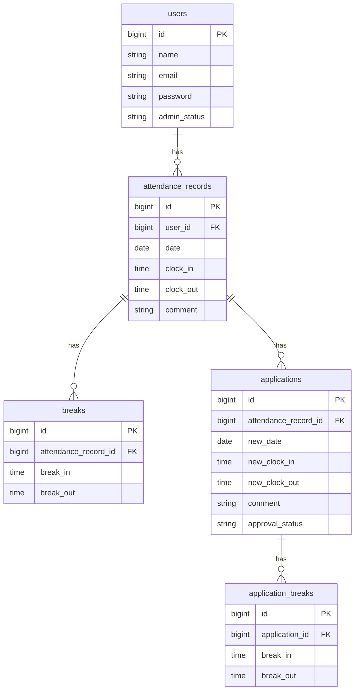

COACHTECH attendance-app 勤怠管理アプリ
attendance-appは打刻や修正を効率化し、勤怠管理するためのWebアプリケーションです。出勤・退勤・休憩時間の管理のための打刻機能、遅刻などの修正依頼機能を備え、さらに管理者機能として勤怠/スタッフ一覧、打刻時間の修正依頼の承認機能も備えています。

作成者
江草　英樹

使用技術
PHP 8.2

Laravel 10.x

Laravel Sanctum（API 認証）

Laravel Fortify（ユーザー認証）

Laravel Notification（DatabaseChannel）

Laravel Scheduler

Laravel Eloquent ORM

Laravel Artisan Console

PHPUnit / Pest

Vite

Tailwind CSS 3.4

Docker / Docker Compose

Laravel Sail

MySQL 8.4

Nginx

phpMyAdmin

Mermaid（ER 図作成）

Git / GitHub

WSL2（Windows 開発環境）



## 環境構築手順（Setup Guide）

1. 前提条件（Prerequisites）

- Docker Desktop
- Git
- （Windows）WSL2
- Node.js（任意、Sail 内で動作）

2. リポジトリのクローン

```bash
git clone git@github.com:Denchan55/attendance-app.git
```

```bash
cd attendance-app
```

3. 依存関係をインストール

```bash
composer install
```

4. .env の作成と設定

```bash
cp .env.example .env
```

必要に応じて以下を確認・修正

```bash
DB_CONNECTION=mysql
DB_HOST=mysql
DB_PORT=3306
DB_DATABASE=laravel
DB_USERNAME=sail
DB_PASSWORD=password
DB_DATABASE_TESTING=testing
```

5. Docker（Laravel Sail）の起動

```bash
./vendor/bin/sail up -d
```

6. 依存関係のインストール

```bash
./vendor/bin/sail npm install
./vendor/bin/sail npm run dev
```

7. アプリケーションキーの生成

```bash
./vendor/bin/sail artisan key:generate
```

8. マイグレーション & シーディング

```bash
./vendor/bin/sail artisan migrate --seed
```

9. アクセス方法

- アプリケーション: http://localhost
- 一般ログイン画面: http://localhost/login
- 管理者ログイン画面: http://localhost/admin/login
-
- phpMyAdmin: http://localhost:8080

テスト実行

```bash
./vendor/bin/sail artisan test
```

補足（Notes）
Vite のポート競合が起きた場合は npm run dev を再実行してください。
Docker の初回起動には時間がかかる場合があります。
Seeder により初期データ（書籍データ・ユーザーなど）が自動投入されます。

## APIエンドポイント一覧

公開APIです。全エンドポイントは `/api/v1` プレフィックス配下に定義されています。

| HTTPメソッド | URI                                           | 概要                       |
| ------------ | --------------------------------------------- | -------------------------- |
| GET          | /api/v1/attendance-records                    | 勤怠一覧                   |
| GET          | /api/v1/attendance-records/{attendanceRecord} | 勤怠詳細                   |
| POST         | /api/v1/attendance-records                    | 勤怠登録（201 Created）    |
| PUT          | /api/v1/attendance-records/{attendanceRecord} | 勤怠更新（200 OK）         |
| DELETE       | /api/v1/attendance-records/{attendanceRecord} | 勤怠削除（204 No Content） |

完了
以上で環境構築は完了です。
アプリケーションを起動し、動作を確認してください。
